# Assistente de Documentos

Um assistente que responde dúvidas sobre os **sistemas instalados na empresa** a partir dos manuais em PDF.
O administrador envia os PDFs e o assistente responde no chat, em **português ou inglês**, citando o arquivo
e a página de onde tirou a resposta.

Tudo roda nos servidores da empresa, com **modelos de linguagem locais** (Ollama): os documentos não saem da
rede interna.

> Esta página é atualizada automaticamente a partir do repositório do projeto.

  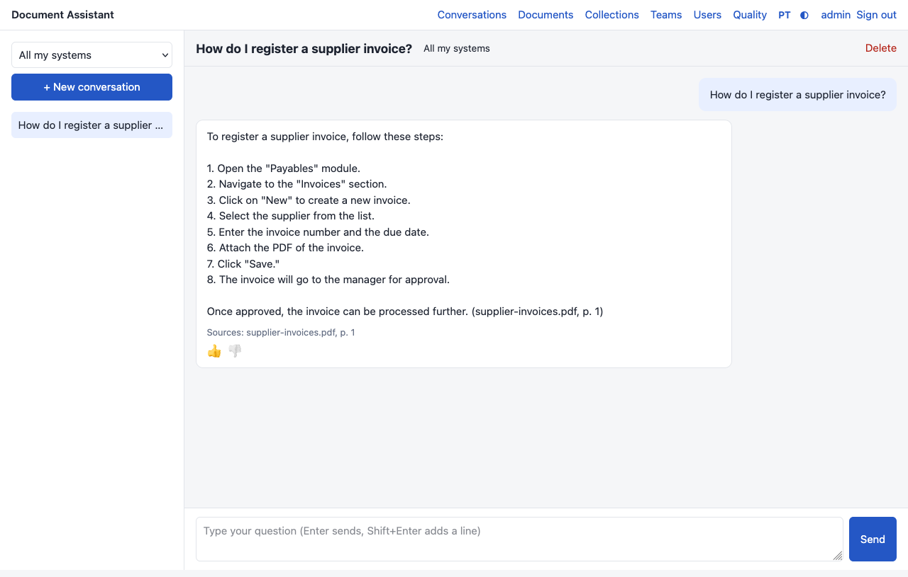
  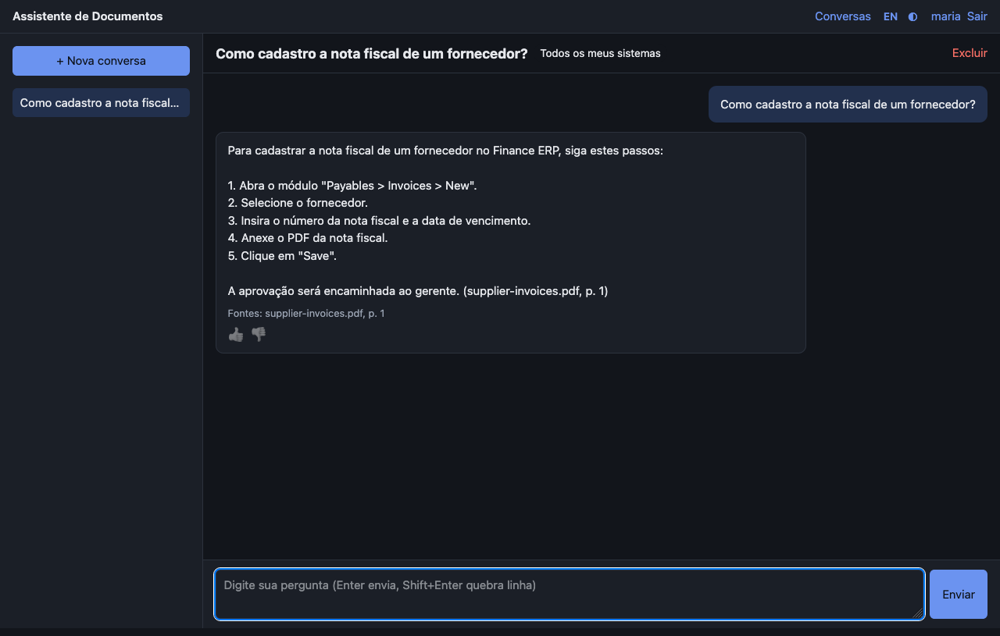

## Como funciona

1. O **administrador** cria um **acervo** para cada sistema (ERP, RH, portal...) e envia os PDFs dele.
2. Os PDFs entram numa **fila** e são processados um por vez: o texto é dividido em trechos e cada trecho vira
   um vetor de busca.
3. O **usuário** pergunta no chat. O assistente busca os trechos mais parecidos **só nos acervos que a equipe
   dele pode consultar** e o modelo escreve a resposta com base neles, citando a fonte.
4. O usuário avalia a resposta (👍/👎), e o administrador acompanha a **qualidade** com perguntas de teste.

## Funcionalidades

### Chat com fontes
Respostas em streaming, no idioma da pergunta, com as fontes citadas. Cada pessoa tem o próprio histórico
de conversas e pode restringir uma conversa a um sistema específico.

### Acervos e equipes
Cada PDF pertence a um acervo (um sistema). Equipes definem quem conversa sobre quais acervos; uma pessoa pode
estar em várias equipes. A regra é conferida a cada pergunta: tirar alguém de uma equipe vale na hora.

  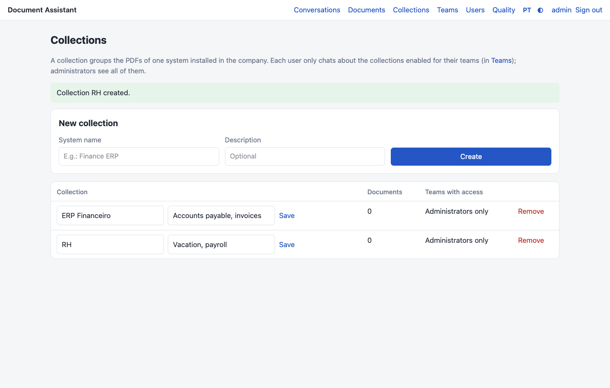
  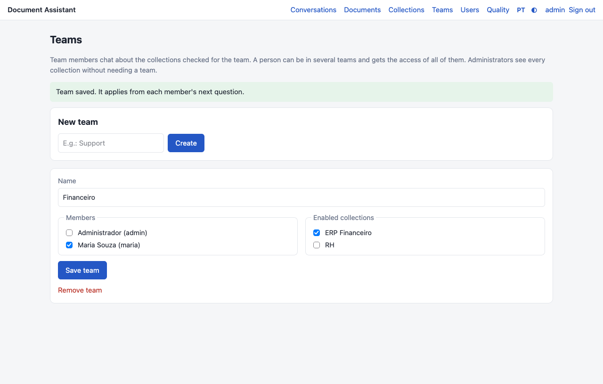

### Fila de processamento
Mesmo enviando 100 PDFs de uma vez, eles são processados **um por vez**, na ordem de envio, para o chat
continuar rápido. A tela mostra o que está em andamento e a posição de cada arquivo.

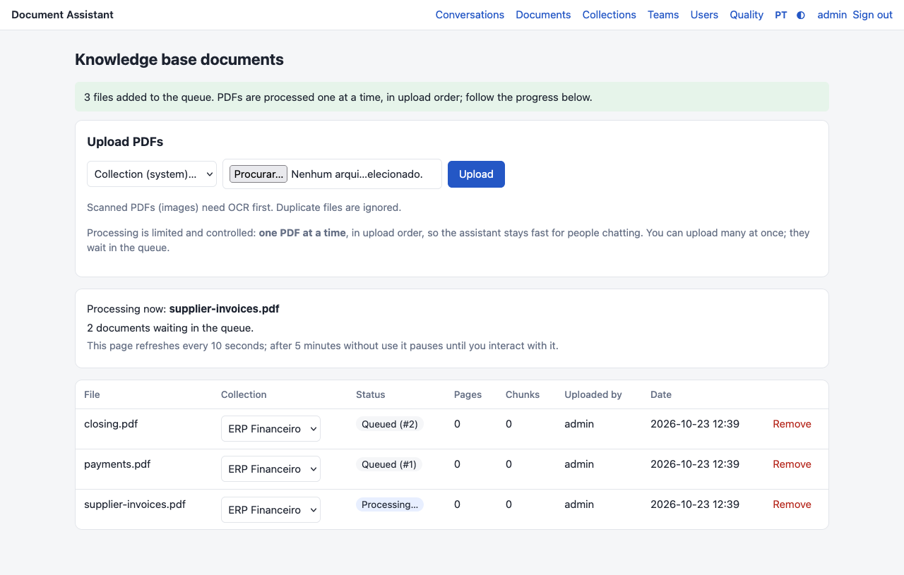

### Qualidade das respostas
O administrador mantém perguntas de teste com a resposta esperada. Cada rodada de avaliação mede se o
assistente **citou o PDF certo** e **o quanto a resposta se parece com a esperada**, guardando a configuração
usada, para comparar antes e depois de qualquer ajuste. Respostas aprovadas pelos usuários viram perguntas
de teste com um clique.

  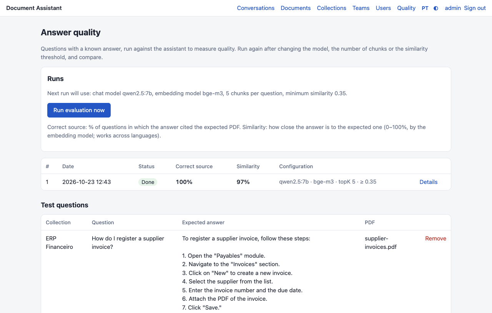
  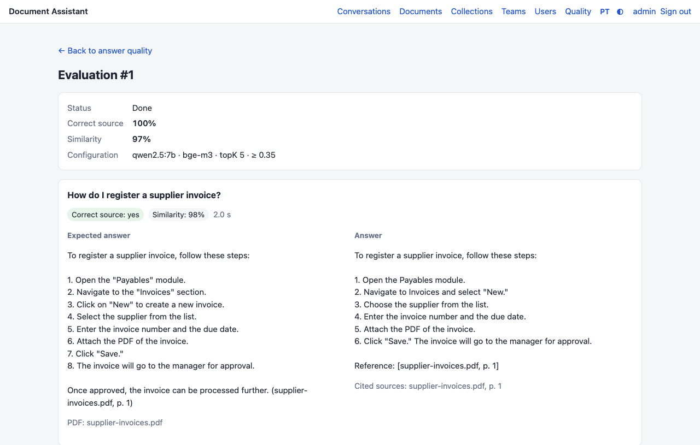

### Acesso seguro
- Login com **verificação em duas etapas** (app autenticador) para todos, com **códigos de recuperação** para
  quem perder o celular.
- **Bloqueio temporário** depois de tentativas erradas de senha ou de código.
- Sessão encerrada após **30 minutos sem uso**; senha provisória obrigatoriamente trocada no primeiro acesso.
- **HTTPS** com certificado automático e cabeçalhos de segurança.

  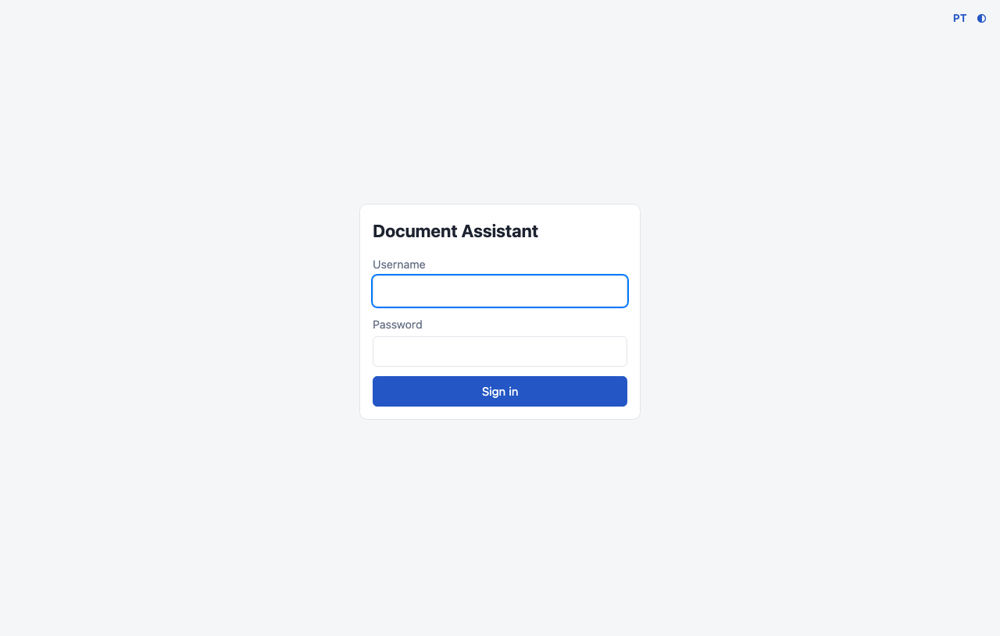
  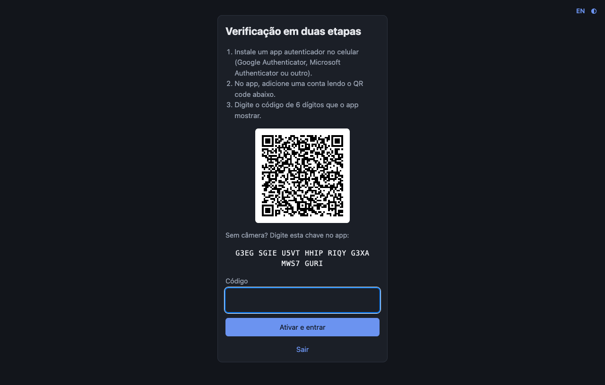
  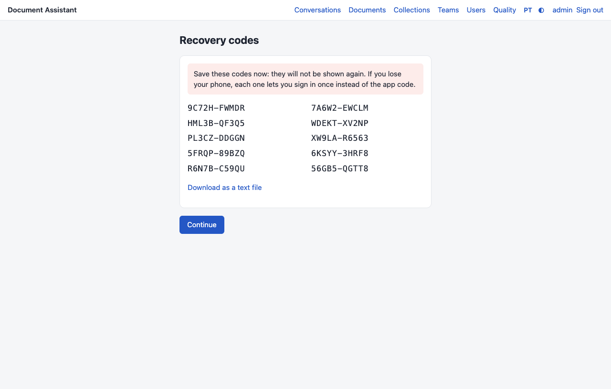

### Inglês e português, claro e escuro, no computador e no celular
A interface segue o idioma do navegador e o tema do sistema operacional, e cada pessoa pode escolher os seus.

  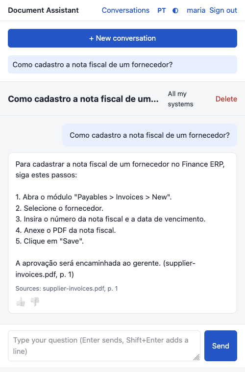
  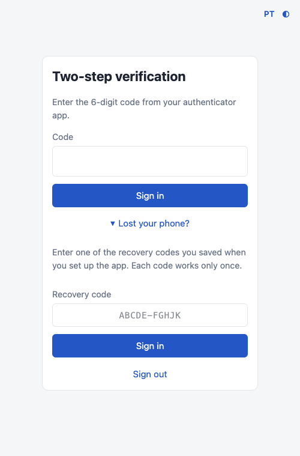

## Arquitetura

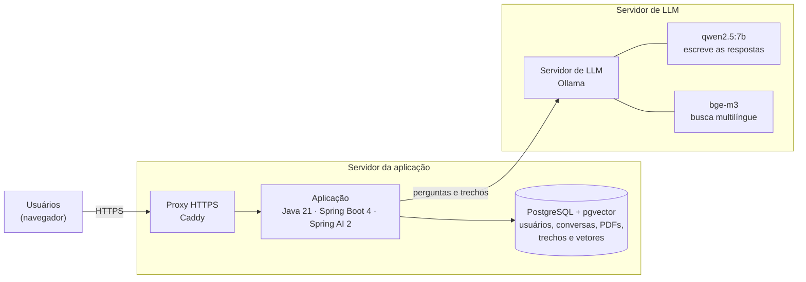

**Fluxo de uma pergunta (RAG):**

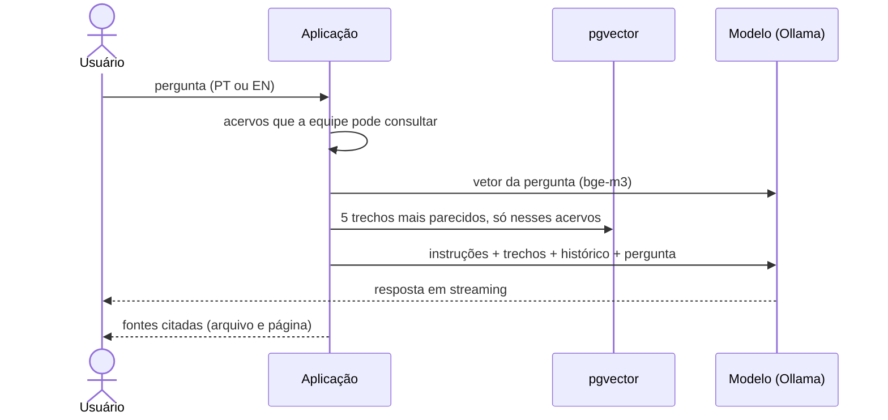

| Camada | Tecnologia |
|---|---|
| Linguagem e framework | Java 21, Spring Boot 4.1, Spring Security 7 (2FA), Spring AI 2 |
| Telas | Thymeleaf, HTML e CSS próprios, sem framework de JavaScript |
| Banco | PostgreSQL 17 com pgvector, migrações com Flyway, sessões no banco |
| Modelos | Ollama: `qwen2.5:7b` (respostas) e `bge-m3` (busca, multilíngue) |
| Infraestrutura | Docker Compose; proxy HTTPS Caddy; servidor de LLM separado; opção de cluster com Docker Swarm |
| Qualidade | Testes automatizados com Postgres real (Testcontainers) e roteiro de telas no Firefox |

A aplicação não guarda nada em disco (PDFs e sessões ficam no banco), então pode rodar em mais de um servidor.

## Próximos passos

- Opção de usar **IAs pagas** (OpenAI, Anthropic, Gemini) por acervo, mantendo a busca local.
- **Fine-tuning** com as perguntas de teste e as respostas aprovadas pelos usuários.
